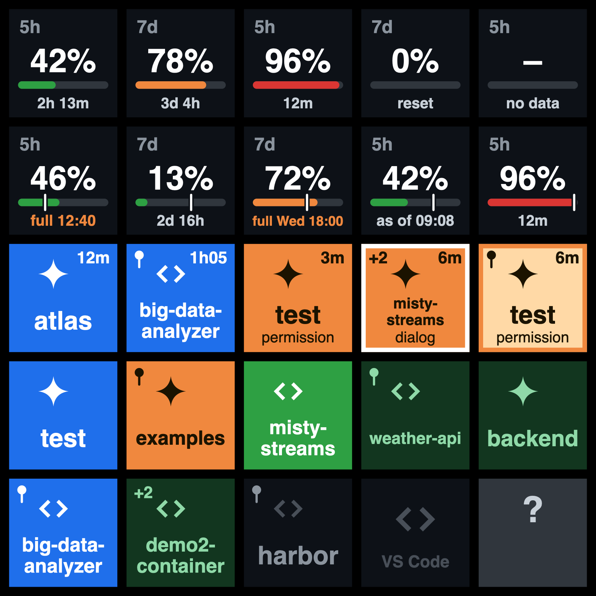

# Code Command Center

Stream Deck keys for AI coding sessions on the Mac. Today it supports Claude Code: the keys show what each of your Claude Code sessions is doing, in the Claude desktop app and in VS Code, bring the session that needs you to the front, and show how much of your plan limits is used.



An independent project, not affiliated with Anthropic, Elgato or Microsoft. Free for noncommercial use; any commercial use needs a license. See [License](#license).

## What the keys show

There are four kinds of key. Put as many of each on your deck as you like.

| Key | Shows | Press |
|---|---|---|
| **Desktop Session** | One Claude Code session of the Claude desktop app | Brings Claude to the front and opens that session |
| **Session in VS Code** | One Claude Code session in VS Code, also inside a Dev Container | Brings that project's VS Code window to the front |
| **Quota 5h** | How much of the 5-hour limit of your plan is used | Nothing, it is a display |
| **Quota 7d** | The same for the weekly limit | Nothing |

### Session keys

The colour of a key is the state of its session:

| Colour | Meaning |
|---|---|
| Blue | Working |
| Orange | Waiting for you: a permission prompt, a question |
| Bright green | Finished since you last looked. Clears when you press the key, or after 30 minutes. |
| Dim green | Idle |
| Dark, with the app's name | No session on this key |
| Dark, project name with a pin | Reserved for a project that is not running |
| Grey, question mark | Sessions on this Mac could not be listed. A session in a Dev Container is still shown. |

Each key is labelled with the session's project folder and carries a mark for its app (see [Logos](#logos)).

- **Clock:** a working or waiting key has a clock in its top right corner, from the first full minute on. On a blue key it is how long the turn has been running; a permission prompt in the middle does not restart it. On an orange key it is how long the session has waited.
- **Reason:** the last line of an orange key says what the session waits for, in the first word Claude Code uses for it: `permission`, `dialog`, `input`.
- **Pulse:** after five minutes of waiting the key gets a white frame and pulses once a second. Pressing the key stops the pulse; the clock keeps counting.
- **Automatic keys** fill with sessions in reading order: waiting first, then working, then the most recently started. A session keeps its key for as long as it runs. A `+2` in the top left corner of the last key counts sessions that have no key.
- **Reserved keys** always show one project and carry a small pin. Reserve a key in either of two ways:
  - Select the key in the Stream Deck app and pick a project under **Session**.
  - Hold the key for a moment on the device. Each hold steps on: Automatic, then each running project in alphabetical order, then Automatic again.

### Quota keys

A quota key shows the percent of the limit used, a bar that turns orange from 70% and red from 90%, and the time until the limit resets.

- **Pace:** a white tick on the bar marks where even use would be at this moment. A bar that ends left of the tick is under pace.
- **Run-out warning:** when the limit would run out before it resets, the footer turns orange and names the time instead of counting down: `full 12:40`, or `full Sat 18:00` when that is not today. The pace behind it is the use of the last hour for the 5-hour limit and of the last day for the weekly one, and it falls once you stop.
- **Freshness:** a new reading arrives when a Claude Code session that runs the mod finishes a turn, and during a turn each time a limit moves by a whole percent. A reading older than an hour is shown as `as of 14:05`; a younger one does not say how old it is.
- **Other devices:** the limits belong to your account, so use from claude.ai, your phone or a Dev Container without the mod is counted, but it only shows up with the next reading.
- **After a reset:** past its reset time a limit reads 0% and `reset` until the next turn opens a new window.

The quota keys need the [mod](#2-the-mod-for-the-quota-keys). Without it they show `no data`.

## Requirements

- A Mac with macOS 13 or newer.
- A Stream Deck with keys, and the Stream Deck app 7.1 or newer.
- Claude Code in the Claude desktop app, in VS Code with the Claude Code extension, or both. It can also be in Dev Containers only. Sessions started with `claude` in a terminal are not shown.
- For sessions in Dev Containers: Docker.
- For the quota keys: a Claude subscription, and a Claude Code that supports mods. Mods are an early-access feature of Claude Code.
- To install from source: Node.js 20 or newer. It is only needed to install; the plugin itself runs on the Node that Stream Deck ships.

Tested with macOS 26, Stream Deck 7.6, the Claude desktop app 2.31226, Claude Code 2.1.293 to 2.1.296, VS Code 1.141 and Docker 29.

## Install

### 1. The Stream Deck plugin

**From a release.** If this repository has [releases](../../releases), download `com.thomasalbin.code-command-center.streamDeckPlugin` from the newest one and double-click it. Stream Deck asks whether to install it.

**From source.** Download this repository (the green **Code** button, then **Download ZIP**) or clone it, open a terminal in its folder and run:

```bash
sh scripts/install.sh
```

The script fetches the plugin's one dependency, Elgato's Stream Deck SDK, and copies the plugin into Stream Deck's plugin folder. The folder you downloaded is not needed afterwards, except for the next step.

Then quit the Stream Deck app and open it again. The four keys are in the category **Code Command Center**; drag them onto your deck.

A layout that works well on a 15-key deck: the two quota keys in the first row, three **Desktop Session** keys in the second and three **Session in VS Code** keys in the third.

### 2. The mod for the quota keys

The session keys work without this step. The quota keys need a small mod inside Claude Code, because that is the only place where Claude Code reports plan usage.

A mod runs inside Claude Code with your permissions, so read it before you install it. It is two short files in [`mod/deck-bridge/hooks/`](mod/deck-bridge/hooks/): [`register.js`](mod/deck-bridge/hooks/register.js) and [`snapshot.js`](mod/deck-bridge/hooks/snapshot.js). What it does and does not do is described under [Safety](#safety).

Then, in the folder of this repository:

```bash
sh scripts/install-mod.sh
```

The script shows what it will change and asks before it does anything. It then:

1. puts a write-protected copy of the mod into `~/.code-command-center/marketplace/`
2. adds two entries to `~/.claude/settings.json`, after saving a backup of that file next to it:

   ```json
   {
     "extraKnownMarketplaces": {
       "code-command-center": {
         "source": { "source": "directory", "path": "/Users/<you>/.code-command-center/marketplace" }
       }
     },
     "enabledPlugins": { "deck-bridge@code-command-center": true }
   }
   ```

Quit Claude, and VS Code if you use Claude Code there, and open it again: sessions load the mod when they start. After your next turn in Claude Code a file appears in `~/.code-command-center/usage/` and the quota keys show their numbers.

Claude Code runs that copy, not the folder you downloaded, so work in the folder does not reach Claude Code until you run the script again. The copy is write-protected so that it is not changed by accident. That is no protection against a program that means to change it: anything that runs under your account could.

**If the quota keys stay at `no data`:** check that the two entries are in `~/.claude/settings.json`, that Claude was restarted, and that you have taken a turn since. If that does not help, quit and reopen Claude once more. If still no file appears in `~/.code-command-center/usage/`, your Claude Code may not support mods yet.

### 3. Dev Containers (optional)

Claude Code inside a Dev Container is an installation of its own, with its own settings. The session keys show its sessions without further steps. For the quota keys to update from turns taken there, the mod has to be in the container as well.

Open the container in VS Code once, so that the Claude Code extension is installed in it. Then list the running Dev Containers:

```bash
sh scripts/install-mod-container.sh
```

and install the mod into one of them, by its id:

```bash
sh scripts/install-mod-container.sh <container id>
```

The script shows what it will change and asks first. It copies the mod into the container, write-protected, and adds the same two entries to the Claude Code settings in the container, after saving a backup of that file there. It uses root in the container only to find the home folder that holds the extension; whatever it writes, it writes as the user who owns that folder. Start a new Claude Code conversation in the container afterwards; the plugin fetches what it reports by itself.

- **After a rebuild:** "Rebuild Container" removes the mod with everything else in the container. Run the script again.
- **Same account:** Claude Code in the container has to be signed in to the same account as on the Mac, or the keys mix the figures of two accounts.
- **Taking it out:** add `--remove` to the command.

### Update

Download the new version and run the same scripts again. `install.sh` replaces the installed plugin and `install-mod.sh` replaces the mod's copy. Restart Stream Deck and Claude afterwards.

### Uninstall

```bash
sh scripts/uninstall.sh
```

It removes the plugin from Stream Deck, the two entries from `~/.claude/settings.json` and the folder `~/.code-command-center/`, after asking. Without the repository: delete `com.thomasalbin.code-command-center.sdPlugin` from `~/Library/Application Support/com.elgato.StreamDeck/Plugins/`, delete `~/.code-command-center/`, and remove the two entries by hand.

The script needs Node.js to change the settings file. Without it, it removes the rest and tells you that the two entries are still there.

Quit and reopen Stream Deck and Claude afterwards. A session that is still running keeps the mod until it is restarted, and writes one more reading, which brings the folder back; delete it again then.

Claude Code keeps its own note of the marketplace and the mod in `~/.claude/plugins/known_marketplaces.json` and `installed_plugins.json`. The script leaves those two files alone, because they belong to Claude Code. With the entries and the folder gone, nothing of the mod is left to run.

In a Dev Container, take the mod out with `sh scripts/install-mod-container.sh <container id> --remove`.

## How it works

- **Sessions on the Mac:** the plugin runs `claude agents --json`, Claude Code's supported way for outside tools to read session state. It uses the Claude Code program that ships inside the Claude desktop app or the VS Code extension, preferring the copy that sessions are already running. What that program does when it is started is described under [Safety](#what-claude-code-does-when-it-is-asked).
- **When it asks:** when a file changes in `~/.claude/sessions/` (used as a signal only, never read), when Claude or VS Code starts or quits, and when the Mac wakes. A timer is the net under a signal that went missing: every 30 seconds while a session is working or waiting, every 60 otherwise.
- **Which app:** one `ps` call shows whether a session was started by the Claude app or by VS Code.
- **Sessions in Dev Containers:** these run inside Docker and are invisible from the Mac. While a VS Code key is visible, the plugin asks Docker which Dev Containers run, finds the Claude Code that VS Code's extension installed inside each, and runs the same `agents --json` there, about every 3 seconds, since nothing on the Mac signals a change in a container.
- **Opening a session in the Claude app:** the plugin opens the link `claude://resume?session=<id>` with the Claude app. For a session the app already runs, the app shows it; nothing is typed or sent. The id is the one Claude Code lists for the session.
- **Bringing a Dev Container window forward:** VS Code's own `code --folder-uri <address>`. The address of the window is looked up in VS Code's `storage.json`.
- **Plan usage:** the mod writes one small file per session to `~/.code-command-center/usage/`. The plugin shows the newest reading of each limit and counts down by itself.
- **Plan usage from Dev Containers:** there the mod writes into the container's own home folder. While a quota key is visible, the plugin reads the file of each session in a container every 20 seconds, by having Docker run `/bin/cat <file>` there.

While no key of the plugin is visible, it starts no program.

## Safety

The plugin was written to be easy to check. It is plain JavaScript with no build step, so the files in `bin/` are the code that runs.

What follows is true of the plugin's own code. The plugin also starts other programs, and what those do is theirs. The one that matters is Claude Code: see [What Claude Code does when it is asked](#what-claude-code-does-when-it-is-asked).

- **Network:** the plugin's code opens no internet connection and no listening port. Its process has one socket, the SDK's local link to the Stream Deck app, which every plugin has. The settings panel uses that same local link and loads nothing from the network.
- **Credentials:** the plugin's code does not touch the Keychain and opens no credential or key file. It never sees a sign-in token: from Claude Code it receives the list of sessions and nothing else.
- **Sessions:** nothing is sent into a session. The plugin cannot submit prompts, approve anything or spend usage. A press can start the Claude app or VS Code if it is not running, and make the Claude app show a session it runs. A press on a key that is reserved for a Dev Container project makes VS Code open that project, which starts the container if it was stopped.
- **Programs:** the plugin starts exactly five, each with fixed arguments, all in `bin/adapters/exec.js`:

  | Program | Arguments | Purpose |
  |---|---|---|
  | Claude Code | `agents --json`, with the setting `CLAUDE_CODE_DISABLE_NONESSENTIAL_TRAFFIC=1` | list sessions on the Mac |
  | `/bin/ps` | `-axo pid=,ppid=,comm=` | see which app owns a session |
  | `/usr/bin/open` | `-b <Claude or VS Code> [folder]`, or `-b <Claude> claude://resume?session=<id>` | bring an app to the front, or Claude on one session |
  | `docker` | `ps`, `top <id>`, `exec [-u <user>] -e <the same setting> <id> <Claude Code> agents --json`, `exec [-u <user>] <id> /bin/cat <reading>` | list sessions in Dev Containers, and read the usage they reported |
  | VS Code's `code` | `--folder-uri <Dev Container address>` | bring a container's window forward |

  Inside a container two things are ever started: Claude Code at the exact place VS Code's extension installs it, with `agents --json`, and `/bin/cat` on a reading of the mod, whose place is fixed by pattern: `<home>/.code-command-center/usage/<session>.json`. Both run as the user whose home folder holds that Claude Code, `/root` or `/home/<name>`, because Claude Code keeps each user's sessions apart. Where the folder is elsewhere, or its name is no user of the container, they run as the container's own user.
- **Files read:** its own folder `~/.code-command-center/`, the mod's readings inside Dev Containers, the names of the folders that hold Claude Code's versions, VS Code's `storage.json` (only to find a Dev Container window's address), and the logo files of the Claude Code extension and of VS Code (see [Logos](#logos)).
- **Files written:** its log, and it deletes usage files older than eight days from `~/.code-command-center/usage/`.
- **Stored settings:** a reserved key stores its project's folder path in your Stream Deck profile.
- **Third-party code:** Elgato's Stream Deck SDK and its four dependencies at run time, and TypeScript with Node's type definitions for checking. Versions are pinned and npm install scripts are disabled.
- **Log:** what the plugin writes to `com.thomasalbin.code-command-center.sdPlugin/logs/` is a handful of fixed messages and the version of Claude Code, never a session name or a path. Elgato's SDK can add messages of its own to the same log.

**The mod** is the one part that runs inside Claude Code. It has one hook on one event (`session.measure`) and makes four calls: `$.clock.now`, `$.env.get("HOME")`, `$.session.id` and `$.fs.write`. It writes the percent used and the reset time of the two limits to a file in `~/.code-command-center/usage/`, and passes the event on unchanged. It reads no prompt and no reply, and sends nothing anywhere. A test (`test/mod.test.js`) reads the mod's source and fails if a hook or a call is added in the open. It is a tripwire, not a lock: code written to get past such a reading could. That is why the mod is two short files that you can read whole.

To check the plugin for yourself, from `com.thomasalbin.code-command-center.sdPlugin`:

```bash
grep -rnE "node:(http|https|net|tls|dgram)|fetch\(" bin/
```

```bash
grep -rln "child_process" bin/
```

The first prints nothing and the second prints `bin/adapters/exec.js` only. While the plugin runs, `lsof -nP -p <pid of the plugin> | grep LISTEN` prints nothing.

These are quick checks of the code as it is written, not proof. They do not cover Elgato's SDK in `node_modules`, which holds the local link to Stream Deck, and a search for words says nothing about code that was written to hide.

### What Claude Code does when it is asked

To list sessions the plugin starts Claude Code, a program of Anthropic's that the plugin does not control. Listing needs no sign-in, but Claude Code does more than list. Measured on a Mac with Claude Code 2.1.295 and 2.1.296, each start:

- runs `/usr/bin/security`, the Keychain tool, twice. That is how Claude Code looks up its own sign-in. The plugin gets none of it.
- runs `git` and `ps`.
- opens a connection to Anthropic, unless it is told not to. The plugin tells it not to, with Claude Code's own setting `CLAUDE_CODE_DISABLE_NONESSENTIAL_TRAFFIC=1`. With that setting no connection was seen in any listing; without it, one was seen in almost every listing.

So the plugin's own code stays off the Keychain and the network, but a tool that records which programs run will show Claude Code and `security` at every listing. That is each time a session changes state, and on a timer in between: every 30 seconds while a session is working or waiting, every 60 otherwise. In a Dev Container the same listing runs about every 3 seconds while a VS Code key is visible. What Claude Code does there was not measured.

A later version of Claude Code may behave differently. This repeats the measurement on your Mac, with and without the setting; it needs no admin rights and changes nothing:

```bash
node scripts/dev/watch-listing.mjs
```

## Logos

The plugin's own logo, three arrow badges in a row that point to the right, is the property of Thomas Albin. The license of the software does not cover it, and it may not be used for anything else, changed, sold or resold: see [The logo](LICENSE.md#the-logo) in LICENSE.md.

This repository contains no logo of Anthropic or Microsoft. On the keys, the plugin draws two plain marks of its own, a sparkle for the Claude app and a pair of angle brackets for VS Code, which is what the picture above shows.

On your Mac the keys can look different: where the Claude Code extension for VS Code is installed, the plugin reads Claude's logo from that extension's files, and where VS Code is installed it reads VS Code's logo from the app. It shows them on your own Stream Deck only. See [NOTICE.md](NOTICE.md).

## Known limits

- A session has a key only while its process runs. After Claude restarts, a session reappears once you open or continue it.
- A desktop key opens its session through a link that the Claude app accepts but that is not on Anthropic's public list of links. If an update of the app drops it, the key only brings Claude forward.
- The Claude app would import a session it does not run when asked for it by that link. So the link is only sent for a live, interactive session on a desktop key, which is one the app started itself; for any other the key only brings Claude forward.
- A VS Code session on the Mac that was started in a subfolder, or in a multi-root workspace, opens a new window instead of focusing the existing one.
- A Dev Container window can only be brought forward once VS Code has recorded it in its state file. Until then the press brings VS Code forward without choosing a window.
- Sessions in a Dev Container change colour up to about three seconds late, because they are polled.
- SSH and other remote sessions do not appear, and neither do sessions started in a terminal.
- The plugin looks for Claude Code in the two places where the Claude app and the VS Code extension keep it. On a Mac that has it in neither, the keys show no sessions of this Mac, and sessions in Dev Containers only. If an update moves Claude Code, that is what you would see until the plugin is adapted.
- In a Dev Container, sessions are asked for as the user whose home folder holds the Claude Code extension, `/root` or `/home/<name>`. That was tested with containers that run as root and with one in which VS Code runs as the user `vscode`. Where the extension is in a folder of another kind, sessions are asked for as the container's own user, which may not find them.
- VS Code means the regular Visual Studio Code app. VS Code Insiders and other editors built on VS Code are not recognised.
- Turns taken in a Dev Container only refresh the quota keys if the mod was installed in that container, and it has to be installed again after every rebuild. A reading from a container shows up to 20 seconds late, and the first one of a session up to a minute late.
- Claude Code does not report when a turn began, so the clocks on session keys count from when the plugin first saw the state. A turn that was already running when Stream Deck started shows less time than it has taken, and a clock can be off after its page was hidden for a while.
- The run-out warning rests on readings the plugin collected while it ran. After Stream Deck restarts it judges by the average since the window opened, until it has an hour of readings for the 5-hour limit or a day for the weekly one.
- The quota keys assume one account. They show the newest reading of any session with the mod, on this Mac or in a Dev Container, so sessions signed in to different accounts mix their figures on the keys.
- A press on a key that is reserved for a Dev Container project opens that project in VS Code, and VS Code starts the container if it was stopped. A press also starts the Claude app or VS Code when it is not running.
- Mods are an early-access feature of Claude Code. An update of Claude Code can break the quota keys until the mod is adapted. The session keys do not depend on it.

## Development

Tests and the type check need Node.js 24 or newer:

```bash
npm install
npm --prefix com.thomasalbin.code-command-center.sdPlugin install
npm test
npm run typecheck
```

- `sh scripts/install.sh --link` links the plugin into Stream Deck instead of copying it, so that it runs from this folder. After a change to its code, quit and reopen Stream Deck. Stream Deck's developer mode would restart the plugin alone, but it also opens a local debugging port, so this project leaves it off.
- `node scripts/dev/mock-streamdeck.mjs` runs the plugin against a stand-in for the Stream Deck app, on Stream Deck's own Node runtime, and reports what each key would show. `--hold` shows a key stepping through projects, and `--press` presses one, which really brings Claude to the front.
- `node scripts/dev/gallery.mjs` draws every kind of key into one picture.
- `node scripts/dev/watch-listing.mjs` shows which programs Claude Code starts and which connections it opens when the plugin asks it for the sessions.
- `sh scripts/install-mod-container.sh` puts the mod into a running Dev Container.
- `sh scripts/dev/try-container-install.sh` tries that script on a throwaway container whose user is not root, and checks that nothing there ends up belonging to root. It needs Docker and fetches the image `ubuntu:22.04` if it is not there yet.
- `sh scripts/pack.sh` builds `dist/com.thomasalbin.code-command-center.streamDeckPlugin`, the file to attach to a release.

Layout:

- `com.thomasalbin.code-command-center.sdPlugin/` is the Stream Deck plugin.
  - `bin/core/` is pure logic with unit tests: parsing, state, key assignment, drawing.
  - `bin/adapters/` holds every side effect.
  - `bin/app/` ties them together.
  - `bin/actions/` are thin Stream Deck classes.
  - `ui/` is the settings panel of a session key.
- `mod/deck-bridge/` is the mod, and `.claude-plugin/marketplace.json` is what lets Claude Code find it.
- `scripts/` holds the install scripts and the development aids.
- `test/` holds the tests.

## License

Copyright (c) 2026 Thomas Albin.

Code Command Center is licensed under the [PolyForm Noncommercial License 1.0.0](LICENSE.md). You may use, copy, change and share it for noncommercial purposes.

Commercial use is not covered. That includes use at or for a company or any other business, also to evaluate or test the software. It needs a commercial license from the author, or the author's explicit written consent: see [COMMERCIAL.md](COMMERCIAL.md).

The source is public, but this is not an open-source license in the formal sense, because it limits commercial use. Contributions are welcome; [CONTRIBUTING.md](CONTRIBUTING.md) says under which terms.

The Code Command Center logo is not part of that license. It is the property of Thomas Albin, with all rights reserved: see [The logo](LICENSE.md#the-logo) in LICENSE.md.

Names and logos of other companies, and the software this project uses, are covered in [NOTICE.md](NOTICE.md).
